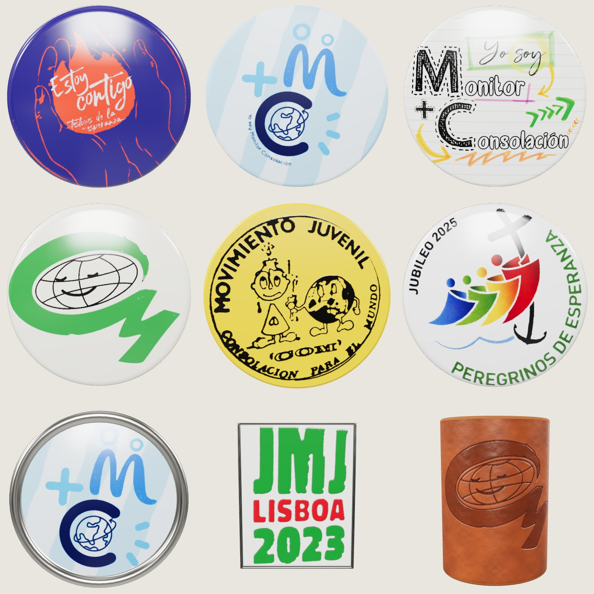

# Piezas 3D del pañuelo (chapas, pin y troncho)

Modelos `.glb` de piezas **de verdad**, hechos a partir de fotos. Igual que
las medallas (`medallas-3d/`), se sirven desde aquí vía jsDelivr, así que **un
archivo solo está disponible cuando ya está en `main`**:

```
https://cdn.jsdelivr.net/gh/mcmespana/mcmapp@main/piezas-3d/<id>.glb
https://cdn.jsdelivr.net/gh/mcmespana/mcmapp@main/piezas-3d/thumbs/<id>.webp
https://cdn.jsdelivr.net/gh/mcmespana/mcmapp@main/piezas-3d/caras/<id>.webp
```



| Archivo                    | Pieza                 | Talla   | Cómo es                                                         |
| -------------------------- | --------------------- | ------- | --------------------------------------------------------------- |
| `estoy-contigo-samuel.glb` | Estoy contigo, Samuel | mediana | Chapa de imperdible, 38 mm. Festival vocacional Samuel 2024     |
| `mc-congreso-1.glb`        | Chapa M+C             | grande  | Chapa mate de 58 mm. Congreso de monitores, 1.er año            |
| `mc-congreso-3.glb`        | Pin M+C               | pequeña | Pin de metal de 18 mm con resina y mariposa. Congreso, 3.er año |
| `monitor-og.glb`           | Monitor OG            | grande  | Chapa de 58 mm, «Yo soy Monitor + Consolación»                  |
| `jmj-lisboa-2023.glb`      | JMJ Lisboa 2023       | mediana | Pin esmaltado rectangular, 30 × 38 mm                           |
| `jubileo-2025.glb`         | Jubileo 2025          | pequeña | Chapa de imperdible, 25 mm                                      |
| `chapa-og.glb`             | Chapa OG              | mediana | Disco de plástico amarillo de 38 mm, la del Movimiento Juvenil  |
| `com-sonriente.glb`        | COM sonriente         | mediana | Chapa de imperdible, 38 mm, logo verde                          |
| `troncho.glb`              | Troncho               | —       | Tubo de cuero de 31 × 22 mm con el logo grabado                 |

Nombres, textos, tallas y medidas están en [`piezas.json`](piezas.json): es la
ficha de cada pieza y se cambia ahí, sin regenerar el modelo.

## Lo que hay que saber

- **Tres tallas**: `pequena`, `mediana` y `grande`. El modelo va a tamaño
  real, en metros. En el pañuelo son el `size` de la pieza (0,7–1,5).
- **El troncho funciona distinto**: va por delante del pañuelo, abrazando la
  tela justo donde se junta, con el nudo debajo; no se mueve ni se
  intercambia (`fijo: true`).
- **Ya están en el pañuelo de pruebas**: son el catálogo de
  `mcm-app/firebase-seed/panuelo.json`. Cosida, cada pieza se pinta con su
  **cara** plana (`caras/<id>.webp`); el `.glb` se abre con «Verla de cerca».
- Cada modelo mira a +Z, con «arriba» en +Y. Las partes van en nodos con
  nombre (`chapa`, `imperdible`, `pin`, `cierre`, `troncho`, `cosido`), por si
  el visor quiere esconder el cierre al coserla.
- Pesan entre 0,3 y 1,2 MB. No hace falta pasarlos por `gltf-transform`.

## Cómo se hacen

La forma es código y la cara es una imagen:

```bash
python3 piezas-3d/_fuente/generar.py            # todas (numpy + Pillow)
python3 piezas-3d/_fuente/generar.py troncho    # solo una
```

- `_fuente/generar.py`: la geometría de cada pieza y sus materiales.
- `_fuente/tex/<id>.png`: la cara, de 1024 px. Sale de una foto de la pieza
  enderezada (la elipse de la foto pasa a círculo) y limpiada: las de pocas
  tintas (Estoy contigo, OG, COM sonriente) están redibujadas con colores
  planos; el Jubileo también está pasado a limpio (blanco puro, tintas
  aplanadas y avivadas). Ninguna cara es una foto tal cual.
- Las dos M+C (chapa y pin) están **redibujadas**: la foto solo sirvió de
  calco de las formas; las tintas son planas, con los azules del logo.
- «Monitor OG» sale del PDF original del diseño, no de una foto.
- La JMJ es un mapa de tintas (`tex/jmj-lisboa-2023-tintas.png`: blanco,
  verde, rojo) calcado de la foto; el metal entre letras lo pone el generador.
- El grabado del troncho usa el dibujo de la chapa verde
  (`tex/troncho-logo-*.png`): es el mismo logo.

**Una chapa redonda nueva** es una imagen en `tex/` y una línea en `PIEZAS`
(con su diámetro). La mejor foto: de frente, sin flash, con luz suave y sin
dedos encima.

`caras/<id>.webp` es la cara plana que cose el visor del pañuelo: en las
chapas el dibujo llega al 86 % del radio (el resto dobla hacia el canto); en
el pin rectangular ocupa la caja de la forma `card`.

Las miniaturas de `thumbs/` (WebP de 512 px, fondo transparente) se sacan
del `.glb` con `<model-viewer>`, con la misma luz que el visor de medallas
(`environment-image="neutral"`, `tone-mapping="aces"`, `exposure="1.2"`).

## Lo que se puede mejorar con mejores fotos

- **Chapa OG**: la foto estaba muy inclinada y con brillos; el texto de abajo
  («CONSOLACIÓN PARA EL MUNDO») queda emborronado.
- **Troncho** y **JMJ**: con los archivos originales de los logos (PNG o
  SVG) quedan exactos; hoy salen de fotos.
- **Estoy contigo**: no se lee el texto pequeño del borde («Festival
  vocacional Samuel 2024»).
